
# WandConnoisseur

A discord bot made in java for noita, it provides flowchart and cast state evaluation, deck animation, spell queries, wisp calculation and more.

I host the bot for the french noita discord [Noita FR](https://discord.gg/6vsxYrpVrp) under the name Wand connoisseur#3805, if you want to add it to your server instead of hosting it yourself you can add it using [this link](https://discord.com/oauth2/authorize?client_id=1406066589505294480).
The bot has localization for french and english but if you want to add new languages (or contribute on anything else) you can contact me there or on the [official noita discord](https://discord.gg/8w7fVNSVrZ).

## Table of Contents
- [WandConnoisseur](#wandconnoisseur)
- [Table of Contents](#table-of-contents)
- [Installation and Configuration](#installation-and-configuration)
- [Commands](#commands)

## Installation and Configuration

requires java 21+ and maven

compile: `mvn compile`

run: `java --enable-preview -cp "target/classes:$(mvn dependency:build-classpath -Dmdep.outputFile=/dev/stdout -q)" org.example.WandConnoisseur`

Before running the bot you will have to replace `BOT_DISCORD_TOKEN` with your API key in [src/main/java/org/example/configFiles/config.properties](https://github.com/zerupo/WandConnoisseur/blob/master/src/main/java/org/example/configFiles/config.properties)

After updating the emotes on your bot you will have to delete `emote.properties` in [src/main/java/org/example/configFiles/](https://github.com/zerupo/WandConnoisseur/tree/master/src/main/java/org/example/configFiles), on the next start the file will be auto-generated and you will be asked to restart the bot.

Program arguments (add them at the very end of the run command):

all files are generated in [src/main/java/org/example/fileOutput](https://github.com/zerupo/WandConnoisseur/tree/master/src/main/java/org/example/fileOutput)

- `-emote` generates 128x128 png icones for every spells
- `-emote_new` generates only emotes that aren't uploaded to the bot
- `-local` instead of the bot runs a local user interface for wand editing (very Work In Progress)
- `-modded` include modded spells
- `-wandstat`generates images for each wand sprites with their stat range
- `-wandstat_svg`generates images for each wand sprites with their stat range in SVG format

## Commands

<strong>cast_state</strong> Returns an image or a menu containing the different cast states.

- `spells`: Spells separated by ",", prefix with 0: max: or inf: to override its charges (default: inf:).
- `always_cast`: List of spells added at the start of every cast.
- `shuffle`: If true, the effective order of spells on the wand will be randomized (default: false).
- `draw`: Number of spells/cast of the wand (default: 1).
- `cast_delay`: Cast delay in frames or seconds, add "f" or "s" at the end to specify (default: 0).
- `recharge_time`: Recharge time in frames or seconds, add "f" or "s" at the end to specify (default: 0).
- `mana_max`: Wand's max mana (default: 1000000).
- `mana_regen`: Wand mana regeneration in mana/s (default: 1000000).
- `spread`: Wand spread (default: 0.0).
- `speed`: Hidden projectile speed multiplier (default: 1.0).
- `type`: Cast state format (default: png).
- `file`: Xml file containing the wand's information (player.xml or located in bones_new).

Most spells have aliases for easier use: `divide by 10` -> `d10`, `black hole` -> `bh`, etc (by default they all have the in-game name and the name used in the code), to get the full list use the command `/list_spells property:  alias type: csv`.

Each spell can be prefixed with the number of charges, either the number directly or `max`/`inf` followed by ":", by default spells have the maximum possible and any modification will still follow the spell's charge rules (eg. `bh`, `3:bh`, `4:bh`, `max:bh`, `inf:bh` are all equivalent), always casts can't have charges.

A prefix can also be added to repeat the spell several times and can be combined with the number of charges: `0:bh:3` will create 3 black holes with 0 charge each.

A projectile crossed out or a cast state in red means that the projectile tree has been broken by a projectile without a `ProjectileComponent` and these projectiles won't appear when casting the wand.

`/cast_state spells: copy trail, linear, triple, ds, inner spell, homebringer, portal, glittering field, d2, d10, d4, d3, fly up, wr`

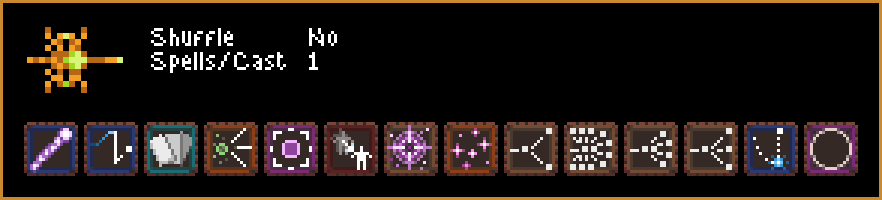

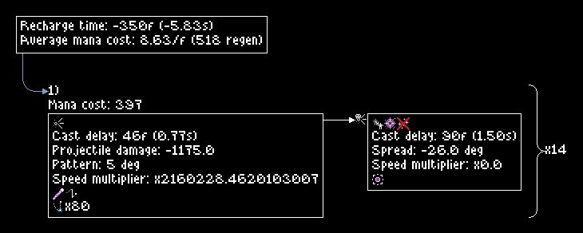

<strong>deck_animation</strong> Returns a menu that lets you view the different steps of the deck/hand/discard.

- `spells`: Spells separated by ",", prefix with 0: max: or inf: to override its charges (default: inf:).
- `always_cast`: List of spells added at the start of every cast.
- `shuffle`: If true, the effective order of spells on the wand will be randomized (default: false).
- `draw`: Number of spells/cast of the wand (default: 1).
- `cast_delay`: Cast delay in frames or seconds, add "f" or "s" at the end to specify (default: 0).
- `recharge_time`: Recharge time in frames or seconds, add "f" or "s" at the end to specify (default: 0).
- `mana_max`: Wand's max mana (default: 1000000).
- `mana_regen`: Wand mana regeneration in mana/s (default: 1000000).
- `spread`: Wand spread (default: 0.0).
- `speed`: Hidden projectile speed multiplier (default: 1.0).
- `file`: Xml file containing the wand's information (player.xml or located in bones_new).

Most spells have aliases for easier use: `divide by 10` -> `d10`, `black hole` -> `bh`, etc (by default they all have the in-game name and the name used in the code), to get the full list use the command `/list_spells property:  alias type: csv`.

Each spell can be prefixed with the number of charges, either the number directly or `max`/`inf` followed by ":", by default spell have the maximum possible and any modification will still follow the spell's charge rules (eg. `bh`, `3:bh`, `4:bh`, `max:bh`, `inf:bh` are all equivalent), always casts can't have charges.

A prefix can also be added to repeat the spell several times and can be combined with the number of charges: `0:bh:3` will create 3 black holes with 0 charge each.

Steps are divided into two types: `card_step` (any change in deck/hand/discard) and `call_stack_step` (change in the actions called without any in the deck/hand/deck) with each `card_step` containing one or more `call_stack_step`.

Steps are displayed in the format `global_step` `card_step`:`call_stack_step`, when using the "Go to" button you can either enter `global_step` or `card_step`:`call_stack_step` to go to the desired step.

"<" and ">" buttons move you only one `global_step` while "<<" and ">>" buttons move you to the next `card_step` skipping any `call_stack_step` in between.

`/deck_animation spells: spark trigger, omega, d2, add trigger, spark, damage, crit, triplicate, chainsaw:3, wr, tp homing, d3`

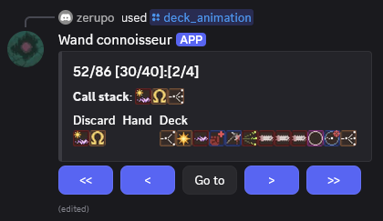

<strong>echo</strong> Replies with your message.

- `text`: The text to return.

`/echo text: this is a test`

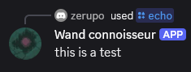

<strong>flowchart</strong> Returns the flowchart in the desired format.

- `spells`: Spells separated by ",", prefix with 0: max: or inf: to override its charges (default: inf:).
- `always_cast`: List of spells added at the start of every cast.
- `shuffle`: If true, the effective order of spells on the wand will be randomized (default: false).
- `draw`: Number of spells/cast of the wand (default: 1).
- `cast_delay`: Cast delay in frames or seconds, add "f" or "s" at the end to specify (default: 0).
- `recharge_time`: Recharge time in frames or seconds, add "f" or "s" at the end to specify (default: 0).
- `mana_max`: Wand's max mana (default: 1000000).
- `mana_regen`: Wand mana regeneration in mana/s (default: 1000000).
- `spread`: Wand spread (default: 0.0).
- `speed`: Hidden projectile speed multiplier (default: 1.0).
- `type`: Flowchart format (default: png).
- `file`: Xml file containing the wand's information (player.xml or located in bones_new).

Most spells have aliases for easier use: `divide by 10` -> `d10`, `black hole` -> `bh`, etc (by default they all have the in-game name and the name used in the code), to get the full list use the command `/list_spells property:  alias type: csv`.

Each spell can be prefixed with the number of charges, either the number directly or `max`/`inf` followed by ":", by default spell have the maximum possible and any modification will still follow the spell's charge rules (eg. `bh`, `3:bh`, `4:bh`, `max:bh`, `inf:bh` are all equivalent), always casts can't have charges.

A prefix can also be added to repeat the spell several times and can be combined with the number of charges: `0:bh:3` will create 3 black holes with 0 charge each.

legend:
- white arrow: draw
- yellow arrow: copy
- yellow arrow + red cross: copy cancelled due to reaching recursion limit
- red arrow: draw that is cancelled or without any spell left to draw
- blue arrow: always cast

`/flowchart spells: triple, add trigger, damage, spark, chainsaw:2, wr always_cast: mana cast_delay: 999 recharge_time: 999`

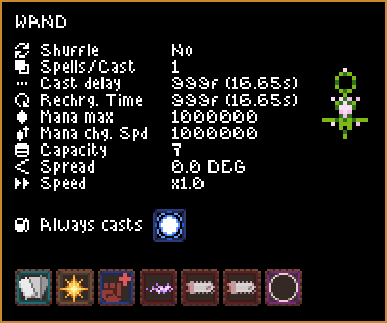

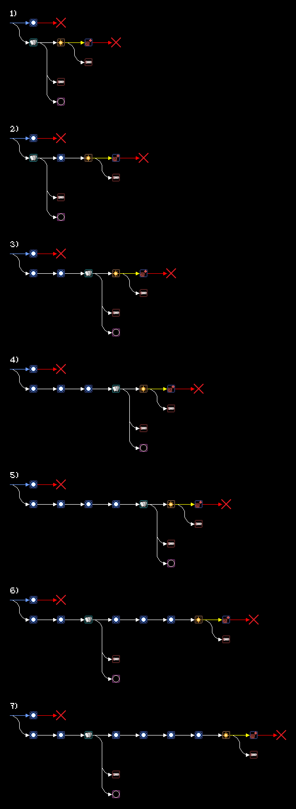

<strong>help</strong> Lists all available commands.

- `command`: Name of a specific command to display its options.

`/help`

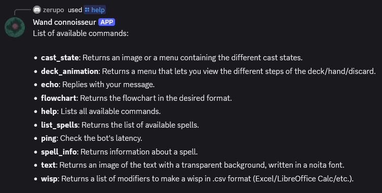

`/help command: flowchart`

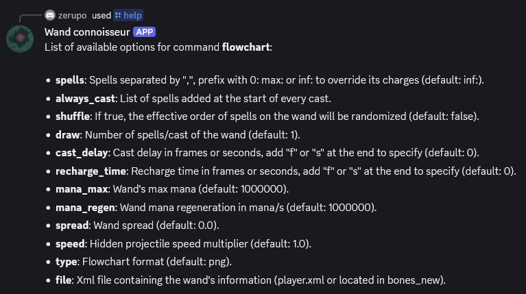

<strong>list_spells</strong> Returns the list of available spells.

- `property`: List of properties to display, separated by ",".
- `condition`: Spell selection condition.
- `sort`: Spell display order.
- `type`: List format (default: message).

Condition must follow the format `[property_name] [operator] [value]` and can be combined using parentheses, "and" and "or" (order of priority is followed).

Several sort can be combined with "," in between, default ordering is ascending but you can add `ASC` or `DESC` to choose the order.

`/list_spells property: lifetime condition: lifetime != 0 sort: lifetime`

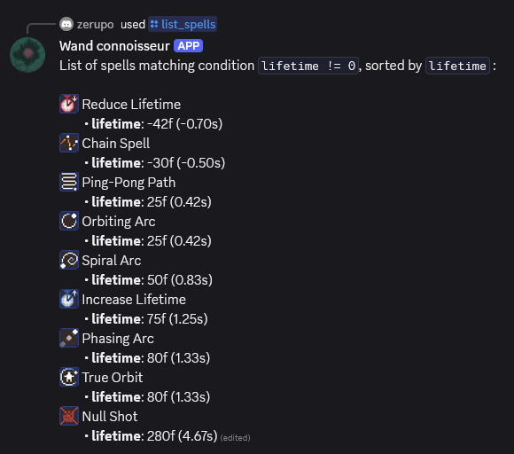

`/list_spells condition: has_related_projectile = true and has_projectile_component = false`

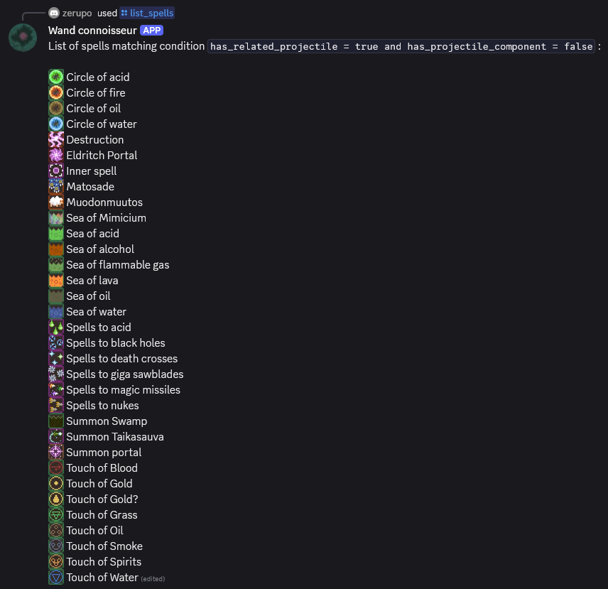

<strong>ping</strong> Check the bot's latency.

`/ping`

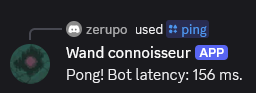

<strong>spell_info</strong> Returns information about a spell.

- `name`: Name of the spell to be described.
- `file`: Returns the spell code as a file instead (default: false).

`/spell_info name: spitter timer`

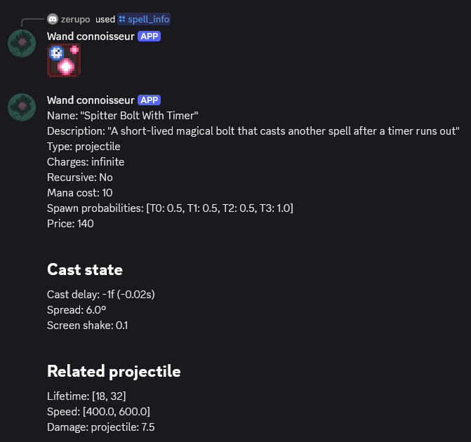

`/spell_info name: double file: true`

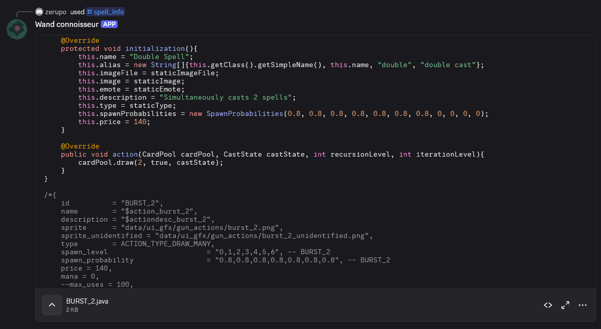

<strong>text</strong> Returns an image of the text with a transparent background, written in a noita font.

- `text`: Text to display.
- `font`: Font to use for the text.
- `size`: Font size to use for the text.
- `color`: Text color in hex format RRGGBB(AA) (default: FFFFFFFF).
- `type`: Text format (default: png).

`/text text: Noita`

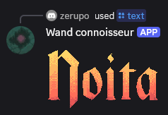

`/text text: secret message font: glyph`

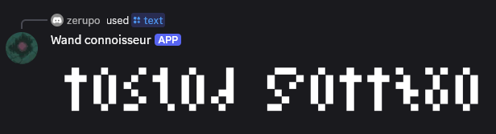

`/text text: cool red font :3 font: pixel size: 20.0 color: FF0000`

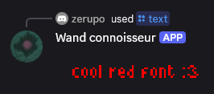

<strong>wisp</strong> Returns a list of modifiers to make a wisp in .csv format (Excel/LibreOffice Calc/etc.).

- `spell`: Spell to transform into a wisp.
- `lifetime_min`: Minimum projectile lifetime, replaces the selected projectile's lifetime.
- `lifetime_max`: Maximum projectile lifetime, replaces the selected projectile's lifetime.
- `nb_modifier`: Maximum number of modifiers of each type (default: 11, max: 21).

Results are ordered by total types of modifiers then total modifiers.

`/wisp spell: healing bolt`

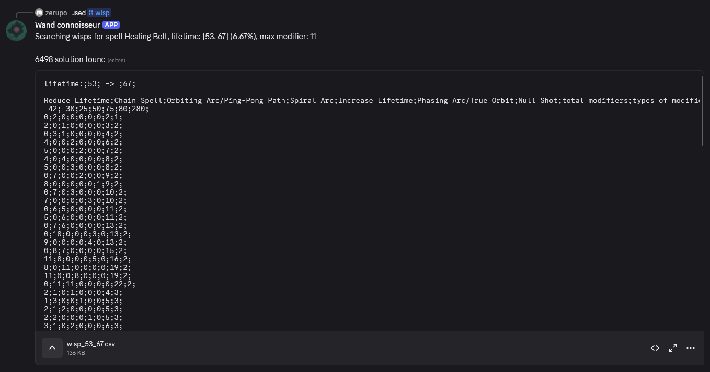

`/wisp lifetime_min: 67 lifetime_max: 69 nb_modifier: 20`

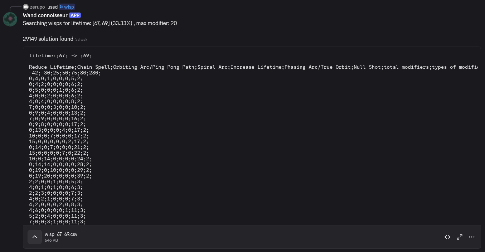

